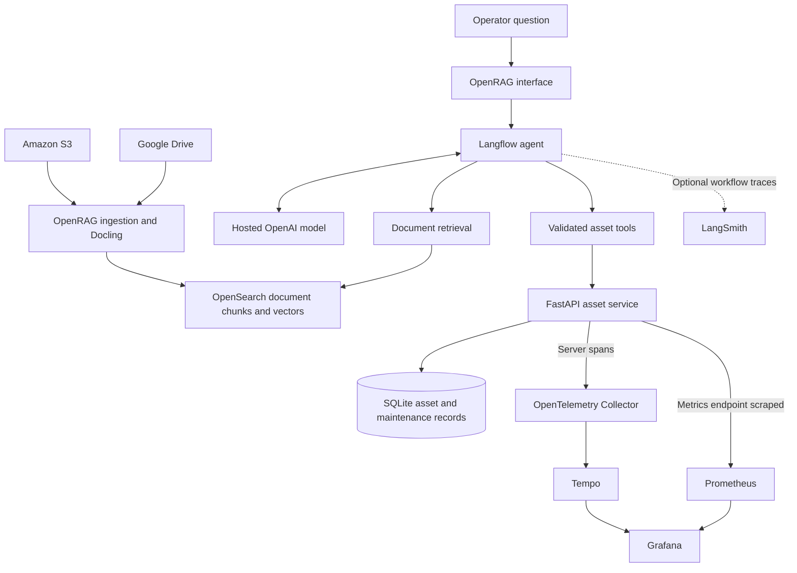

# Property Operations RAG Workbench

**Property operations answers backed by documents, asset records and inspectable evidence.**

Property teams work across service contracts, equipment manuals, operating
procedures and maintenance records. Answering a question often means finding
the right document, checking its revision and reconciling it with the recorded
state of an asset.

Property Operations RAG Workbench brings these information sources into a
single question-and-answer workflow. Its design combines retrieval-augmented
generation (RAG) with read-only database tools, operational telemetry and
evidence-based evaluation.

**Status:** Under active development. The repository currently contains project
scaffolding; implementation and verified results will be added incrementally.

## The problem in one question

> When is Building A's air-handling unit next due for service, and what
> preparation procedure applies?

A useful answer needs two kinds of evidence:

| Information needed | Source of truth |
| --- | --- |
| The recorded next service date | Structured asset and maintenance records |
| The applicable preparation procedure | The current operating procedure or manual |

The target workflow retrieves the procedure, calls the asset API and assembles
an answer with references to both sources. Missing dates remain unknown, failed
lookups remain visible, and a superseded procedure must not be presented as the
current instruction.

## Design priorities

- **Grounded answers:** retain document citations and database references so a
  reader can inspect the supporting evidence.
- **Controlled tool access:** expose validated asset lookups through an API,
  with server-defined scope and parameterised queries.
- **Honest failure handling:** distinguish missing information, denied access,
  unavailable services and unsupported questions.
- **Observable execution:** investigate API requests through traces, metrics
  and logs, with optional LangSmith visibility into the agent workflow.
- **Measured quality:** assess answer correctness, grounding, citations, tool
  behaviour and scope using a repeatable evaluation process.

## Target architecture

Document ingestion prepares the retrieval index. Structured lookups happen at
question time through the API. Database facts remain separate from document
knowledge, with each contributing its own evidence to the answer.

The diagram describes the target design. API server spans and LangSmith runs
are separate telemetry paths, associated manually where verified; they do not
form an automatic end-to-end trace of every model operation or database query.

## Technology choices

| Technology | Role and rationale |
| --- | --- |
| OpenRAG, Docling and OpenSearch | Document ingestion, parsing and retrieval |
| Google Drive and Amazon S3 | Separate source repositories for procedures, contracts and manuals |
| Langflow | Visual orchestration and model-visible tool definitions |
| Hosted OpenAI models | Generation and embeddings without running a local model |
| FastAPI and SQLite | A small, deterministic service for read-only operational facts |
| OpenTelemetry, Tempo, Prometheus and Grafana | API request diagnostics and operational visibility |
| LangSmith, optional | Agent workflow inspection with payload privacy controls |

The development environment uses WSL2 and Docker Desktop. The initial design
keeps the database local and stages supporting services to manage memory and
cost on a single machine.

## Evaluation approach

The prepared fictional dataset spans two buildings, with current documents,
archived revisions, asset records and maintenance history. Evaluation scenarios
cover document questions, database questions, combined answers, unavailable
information, access boundaries and service failures.

Answers will be reviewed against source evidence. Reports will distinguish
completed tests from blocked or untested cases, and separate answer quality
from operational health. A successful HTTP request or a visible trace alone
does not establish that an answer is correct.

Measured results and reproduction instructions will be published alongside the
implementation once verified.

## Security and operational scope

All business records are fictional. The intended asset API uses fixed
demonstration credentials with server-defined building scopes. Authenticated
end-user identity propagation and document retrieval authorisation require
separate implementation and verification.

The initial system is read-only. It does not create work orders or permit
model-generated SQL. Credentials, runtime environments and raw evidence stay
outside this source repository; only reviewed source files, fictional fixtures
and sanitised evidence are intended for publication.

## Project foundations

- [OpenRAG](https://docs.openr.ag/)
- [Langflow](https://github.com/langflow-ai/langflow)
- [Docling](https://github.com/docling-project/docling)
- [OpenTelemetry](https://opentelemetry.io/)
- [LangSmith](https://www.langchain.com/langsmith)

Dependencies retain their respective licences. A licence for this repository's
original work has not yet been selected.
