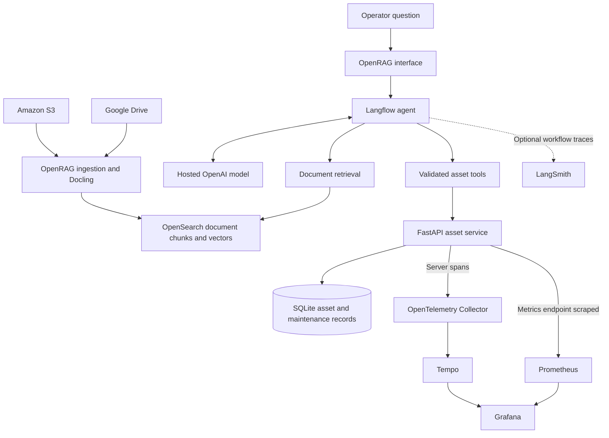

# Property Operations RAG Workbench

Answer property operations questions with evidence from contracts, manuals,
procedures and asset records.

Property teams often need to check several sources to answer one question.
The vendor sits in a contract, the preparation steps in a procedure, and the
next service date in a maintenance record. This project brings those sources
into a retrieval-augmented generation (RAG) workflow with document citations
and planned read-only asset lookups.

## Current status

The local OpenRAG deployment ingests ten contracts and manuals from Amazon S3
and twelve profiles and SOPs from Google Drive. A retrieval smoke test returned
an answer citing both an S3 contract and a Drive procedure.

This repository contains the fictional dataset, offline validation tools,
connector helpers and the S3 investigation with screenshots. The FastAPI asset
service, database tools and observability stack remain planned work.

## S3 integration investigation

OpenRAG 0.8.0 hid S3 from the interface despite configured AWS credentials.
Source inspection identified separate backend availability and frontend
visibility gates. A local development override enabled the backend connector;
the native API then ingested S3 documents while Google sign-in and Drive
remained active.

The case study records the investigation, an intermediate parsing failure,
the workaround and the successful retrieval test.

- [Engineering case study](docs/engineering/s3-connector-workaround.md)
- [Screenshots and validation results](docs/evidence/s3-validation.md)
- [Setup and ingestion helpers](scripts/s3/README.md)

The workaround applies to this release and local development setup. Production
readiness, access isolation, automatic synchronization and broader answer
quality still need testing.

## Example question

> When is Building A's air-handling unit next due for service, and what
> preparation procedure applies?

| Information needed | Source |
| --- | --- |
| Next service date | Asset and maintenance records |
| Preparation steps | Current procedure or equipment manual |

The planned workflow retrieves the procedure, calls the asset API and cites
both sources. If a date is missing or a lookup fails, the answer should say so.
It should use the current procedure rather than a superseded revision.

## Design decisions

- Keep database facts separate from document retrieval. Query asset records
  through validated API tools with parameterised SQL and server-defined scope.
- Cite supporting documents and database references so readers can check answers.
- Distinguish missing information, denied access and service failures.
- Use traces and metrics to inspect API requests, with optional LangSmith
  tracing for the agent workflow.
- Evaluate factual accuracy, citations, tool use and access boundaries separately.

## Target architecture



Ingestion parses source documents and builds the OpenSearch index. At question
time, the agent retrieves document chunks and, once implemented, calls the
asset API for structured records.

The diagram includes planned components. API server spans and LangSmith runs
follow separate telemetry paths. The design uses manual association where
verified; it does not provide an automatic end-to-end trace of every model
operation or database query.

## Technology choices

| Technology | Purpose |
| --- | --- |
| OpenRAG, Docling and OpenSearch | Ingest, parse, index and retrieve documents |
| Google Drive and Amazon S3 | Store procedures, contracts and manuals |
| Langflow | Orchestrate the agent and define its tools |
| Hosted OpenAI models | Generate answers and embeddings without a local model |
| FastAPI and SQLite | Provide planned read-only asset and maintenance lookups |
| OpenTelemetry, Tempo, Prometheus and Grafana | Provide planned API traces, metrics and dashboards |
| LangSmith, optional | Inspect agent runs with payload privacy controls |

Development runs on WSL2 and Docker Desktop. The design keeps the database
local and runs supporting services in stages to manage memory and cost on
one machine.

## Repository layout

| Path | Contents |
| --- | --- |
| `data/documents/google_drive/` | 12 current profiles and operating procedures |
| `data/documents/s3/` | 10 current contracts and equipment manuals |
| `data/documents/manifest.json` | Document IDs, revisions, paths and SHA256 hashes |
| `data/database/` | Fictional records in CSV and SQL to rebuild SQLite |
| `evaluations/cases.jsonl` | 50 cases with expected answers and evidence references |
| `evaluations/fixtures/` | Superseded procedures and access expectations |
| `tools/` | Offline validation and ingestion inventory tools |
| `docs/engineering/` | Integration investigations and technical decisions |
| `docs/evidence/` | Validation results and their limits |
| `docs/images/s3/` | Reviewed investigation screenshots |
| `scripts/s3/` | Local S3 setup and native ingestion helpers |

Ingest only current manifest entries under `data/documents/`. Do not ingest
the repository recursively: evaluation answers, archived fixtures, database
records and the manifest must stay outside the retrieval index. See the
[dataset reference](data/README.md) and [evaluation reference](evaluations/README.md).

## Run the offline checks

Use Python 3.10 or later. The tools need only the standard library; they do not
require credentials or running OpenRAG services. Run from the repository root:

```bash
python3 tools/validate_dataset.py
```

The validator checks document hashes, evidence references, expected SQL results,
database integrity, CSV consistency and asset manual references. It rebuilds
SQLite in memory. These checks validate the dataset, not live retrieval or
authorization.

To prepare a local upload selection and private source ledger:

```bash
python3 tools/ingestion_inventory.py prepare --dataset data/documents --out runtime/ingestion
```

Choose an output directory that does not exist yet. The command prepares files
and `source_ledger.csv`; it does not upload them. After recording ingestion
metadata, check the ledger structure:

```bash
python3 tools/ingestion_inventory.py audit --dataset data/documents --ledger runtime/ingestion/source_ledger.csv
```

Keep the ledger under the ignored `runtime/` directory. It can contain account
aliases and provider references.

## Evaluation and access boundaries

The fictional dataset covers two buildings, current and superseded documents,
asset records and maintenance history. The evaluation cases cover document
retrieval, database lookups, combined answers, missing information, access
boundaries and service failures.

The [S3 validation record](docs/evidence/s3-validation.md) reports the current
retrieval smoke test. Broader evaluation remains pending. A successful request
or visible trace alone does not prove that an answer is correct.

The planned asset API uses fixed demonstration credentials and server-defined
building scopes. End-user identity propagation and document authorization need
separate implementation and tests. A model refusal or user-editable search
filter does not enforce an access boundary.

Asset tools will support read-only lookups, not work-order creation or
model-generated SQL. Keep credentials, runtime configuration and private raw
evidence outside the repository. Publish only reviewed source, fictional data
and approved evidence.

## Upstream projects

- [OpenRAG](https://docs.openr.ag/)
- [Langflow](https://github.com/langflow-ai/langflow)
- [Docling](https://github.com/docling-project/docling)
- [OpenTelemetry](https://opentelemetry.io/)
- [LangSmith](https://www.langchain.com/langsmith)

Dependencies retain their own licences. This repository does not yet specify
a licence for its original work.
