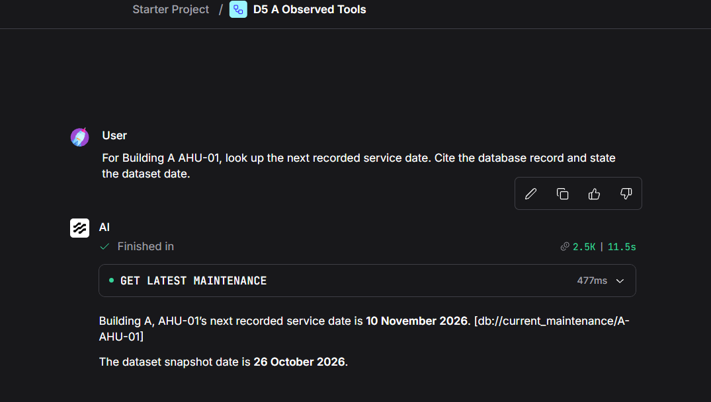
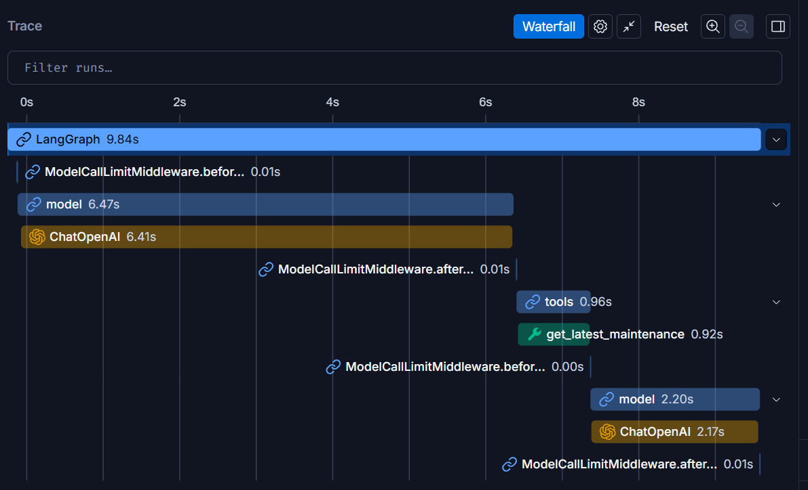
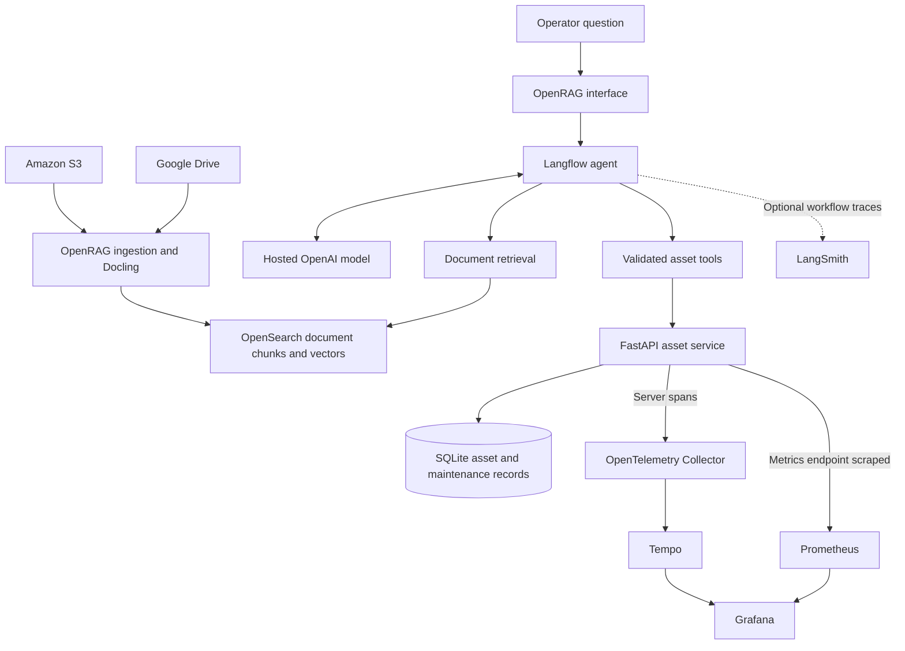

# Property Operations RAG Workbench

Answer property operations questions with evidence from contracts, manuals,
procedures and asset records.

Property teams often need to check several sources to answer one question.
The vendor sits in a contract, the preparation steps in a procedure, and the
next service date in a maintenance record. This project brings those sources
into a retrieval-augmented generation (RAG) workflow with document citations
and read-only asset lookups.

## Project status

**Under active development.**

The local OpenRAG deployment ingests ten contracts and manuals from Amazon S3
and twelve profiles and SOPs from Google Drive. A retrieval smoke test returned
an answer citing both an S3 contract and a Drive procedure.

The asset API and two custom Langflow tools now support recorded asset and
maintenance lookups. API tests check fixed A/B credential scopes; operator
captures show missing-date handling, clarification and a combined database/SOP
answer. Exact citations in that combined answer and document access isolation
still need verification. A direct component result now correlates with an API
server span stored in Tempo and viewed in Grafana. Live dashboard, denial and
broader evaluation evidence remains incomplete. A LangSmith model/tool waterfall
is now captured; exact local-run association and privacy verification remain
separate evidence gaps.

## Asset API and agent tools

The agent requests a specific asset or maintenance record through FastAPI.
The API checks its fixed credential's building scope before running a
parameterised, read-only SQLite query. A missing next service date stays
unknown rather than becoming an inferred date.

The managed OpenRAG flow combines these lookups with document retrieval. Both
calls completed in the supplied combined run, but the final answer did not
visibly cite exact database and document references. That is an open provenance
check, not a complete citation pass.

- [API source, contract and reproduction](services/asset_api/README.md)
- [Langflow components and setup](integrations/langflow/README.md)
- [Integration investigation](docs/engineering/asset-tools-integration.md)
- [Validation results and screenshots](docs/evidence/asset-tools-validation.md)
- [Why use an API alongside database access controls?](docs/decisions/0001-api-and-database-access.md)
- [Fixed scopes versus user identity](docs/decisions/0002-fixed-scope-and-user-identity.md)
- [Recorded facts and source attribution](docs/decisions/0003-recorded-facts-and-source-attribution.md)

## S3 integration investigation

OpenRAG 0.8.0 hid S3 from the interface despite configured AWS credentials.
Source inspection identified separate backend availability and frontend
visibility gates. A local development override enabled the backend connector;
the native API then ingested S3 documents while Google sign-in and Drive
remained active.

The case study records the investigation, an intermediate parsing failure,
the workaround and the successful retrieval test.

- [Engineering case study](docs/engineering/s3-connector-workaround.md)
- [Screenshots and validation results](docs/evidence/s3-validation.md)
- [Setup and ingestion helpers](scripts/s3/README.md)

The workaround applies to this release and local development setup. Production
readiness, access isolation, automatic synchronization and broader answer
quality still need testing.

## API observability

The API emits business-request counters, duration histograms and one server
span per request. The Collector forwards spans to Tempo; Prometheus scrapes
metrics directly. Grafana queries both stores. Tool results retain request and
trace IDs so a specific lookup can be checked against its stored span.

- [Monitoring source, tests and setup](observability/README.md)
- [Operations and resource-pressure investigation](docs/engineering/api-observability.md)
- [Trace-correlation evidence and remaining checks](docs/evidence/api-observability.md)

The captured request completed in 7.53 ms at the API boundary. That single
observation is not a performance benchmark or an end-to-end agent trace.
A later agent lookup returned the recorded service date with a database citation.
Its tool result, API log and Tempo span share a request ID. A supplied LangSmith
waterfall shows the model-tool-model sequence; exact run association and payload
privacy are not demonstrated by those captures. See the
[agent observability evidence](docs/evidence/agent-maintenance-observability.md)
and [troubleshooting guide](docs/engineering/agent-api-observability.md).

### Observed maintenance lookup

The agent called the maintenance tool, returned the recorded service date and
cited the database reference. It stated the dataset snapshot date separately.



The supplied LangSmith waterfall shows a model call, the maintenance tool and a
second model call that constructs the answer. Its nested durations overlap.



The [full evidence record](docs/evidence/agent-maintenance-observability.md)
also includes the matching API log and Tempo span, the timing discrepancy and
the limits of the LangSmith association and privacy evidence.

## Example question

> When is Building A's air-handling unit next due for service, and what
> preparation procedure applies?

| Information needed | Source |
| --- | --- |
| Next service date | Asset and maintenance records |
| Preparation steps | Current procedure or equipment manual |

The workflow retrieves the procedure and calls the asset API. Its answer must
cite each source separately. If a date is missing or a lookup fails, the answer
should say so.
It should use the current procedure rather than a superseded revision.

## Design decisions

- Keep database facts separate from document retrieval. Query asset records
  through validated API tools with parameterised SQL and server-defined scope.
- Cite supporting documents and database references so readers can check answers.
- Distinguish missing information, denied access and service failures.
- Use traces and metrics to inspect API requests, with optional LangSmith
  tracing for the agent workflow.
- Evaluate factual accuracy, citations, tool use and access boundaries separately.

## Development approach

Test from the data outward: validate the snapshot, test the API and bounded
client, verify container connectivity, then exercise custom components and
agent behaviour. Check missing data and denied requests as well as successful
lookups. Inspect both tool execution and the final answer before recording an
integration result.

The [development methodology](docs/engineering/development-methodology.md)
explains the sequence, troubleshooting decisions and evidence standards.
Passing one layer does not certify the next; incomplete citation and access
checks remain explicit.

## Target architecture



Ingestion parses source documents and builds the OpenSearch index. At question
time, the agent retrieves document chunks and calls the asset API for structured
records. The API, SQLite and local telemetry paths are implemented. A successful API
trace has been observed in Tempo. Dashboard configuration is supplied; a populated
live dashboard remains unverified. Agent-level LangSmith export is observed,
with the correlation and privacy limits documented in the evidence record.

The diagram includes planned components. API server spans and LangSmith runs
follow separate telemetry paths. The design uses manual association where
verified; it does not provide an automatic end-to-end trace of every model
operation or database query.

## Technology choices

| Technology | Purpose |
| --- | --- |
| OpenRAG, Docling and OpenSearch | Ingest, parse, index and retrieve documents |
| Google Drive and Amazon S3 | Store procedures, contracts and manuals |
| Langflow | Orchestrate the agent and define its tools |
| Hosted OpenAI models | Generate answers and embeddings without a local model |
| FastAPI and SQLite | Serve read-only asset and maintenance lookups with fixed credential scopes |
| OpenTelemetry, Tempo, Prometheus and Grafana | Collect API spans and metrics; inspect traces and configured dashboards |
| LangSmith, optional | Inspect agent runs with payload privacy controls |

Development runs on WSL2 and Docker Desktop. The design keeps the database
local and runs supporting services in stages to manage memory and cost on
one machine.

## Repository layout

| Path | Contents |
| --- | --- |
| `data/documents/google_drive/` | 12 current profiles and operating procedures |
| `data/documents/s3/` | 10 current contracts and equipment manuals |
| `data/documents/manifest.json` | Document IDs, revisions, paths and SHA256 hashes |
| `data/database/` | Fictional records in CSV and SQL to rebuild SQLite |
| `evaluations/cases.jsonl` | 50 cases with expected answers and evidence references |
| `evaluations/fixtures/` | Superseded procedures and access expectations |
| `tools/` | Offline validation and ingestion inventory tools |
| `services/asset_api/` | API, private runtime preparation, tests and Docker build |
| `integrations/langflow/` | Bounded client, two custom tools and adapter tests |
| `infra/asset-api.compose.yaml` | Private-network API deployment definition |
| `observability/` | Instrumented API wrapper, monitoring stack, dashboard and tests |
| `docs/decisions/` | Architecture decisions and production trade-offs |
| `docs/engineering/` | Integration investigations |
| `docs/evidence/` | Validation results and their limits |
| `docs/images/s3/` | Reviewed S3 investigation screenshots |
| `docs/images/asset-tools/` | Reviewed API and agent integration screenshots |
| `scripts/s3/` | Local S3 setup and native ingestion helpers |

Ingest only current manifest entries under `data/documents/`. Do not ingest
the repository recursively: evaluation answers, archived fixtures, database
records and the manifest must stay outside the retrieval index. See the
[dataset reference](data/README.md) and [evaluation reference](evaluations/README.md).

## Run the offline checks

Use Python 3.10 or later. The tools need only the standard library; they do not
require credentials or running OpenRAG services. Run from the repository root:

```bash
python3 tools/validate_dataset.py
```

The validator checks document hashes, evidence references, expected SQL results,
database integrity, CSV consistency and asset manual references. It rebuilds
SQLite in memory. These checks validate the dataset, not live retrieval or
authorization.

To prepare a local upload selection and private source ledger:

```bash
python3 tools/ingestion_inventory.py prepare --dataset data/documents --out runtime/ingestion
```

Choose an output directory that does not exist yet. The command prepares files
and `source_ledger.csv`; it does not upload them. After recording ingestion
metadata, check the ledger structure:

```bash
python3 tools/ingestion_inventory.py audit --dataset data/documents --ledger runtime/ingestion/source_ledger.csv
```

Keep the ledger under the ignored `runtime/` directory. It can contain account
aliases and provider references.

After installing the pinned API requirements in a repository virtual environment,
run the service and adapter suites:

```bash
.venv/bin/python -m unittest discover -s services/asset_api -p 'test_api.py' -v
.venv/bin/python -m unittest discover -s integrations/langflow -p 'test_tool_client.py' -v
```

These tests create temporary databases and credentials and make no model calls.
See the API README for environment setup. Repository packaging does not replace
an existing running deployment; migrate it deliberately.

## Evaluation and access boundaries

The fictional dataset covers two buildings, current and superseded documents,
asset records and maintenance history. The evaluation cases cover document
retrieval, database lookups, combined answers, missing information, access
boundaries and service failures.

The [S3 record](docs/evidence/s3-validation.md) covers cross-source document
retrieval. The [asset-tool record](docs/evidence/asset-tools-validation.md)
separates 14 API tests, 12 adapter tests and operator observations. Broader
evaluation remains pending. A successful request or visible trace alone does
not prove answer correctness, source attribution or document authorization.

The asset API uses fixed demonstration credentials and server-defined building
scopes. All callers of a configured flow share its database credential.
End-user identity propagation and document authorization need
separate implementation and tests. A model refusal or user-editable search
filter does not enforce an access boundary.

Asset tools support read-only lookups, not work-order creation or
model-generated SQL. Keep credentials, runtime configuration and private raw
evidence outside the repository. Publish only reviewed source, fictional data
and approved evidence.

## Upstream projects

- [OpenRAG](https://docs.openr.ag/)
- [Langflow](https://github.com/langflow-ai/langflow)
- [Docling](https://github.com/docling-project/docling)
- [OpenTelemetry](https://opentelemetry.io/)
- [LangSmith](https://www.langchain.com/langsmith)

Dependencies retain their own licences. This repository does not yet specify
a licence for its original work.
