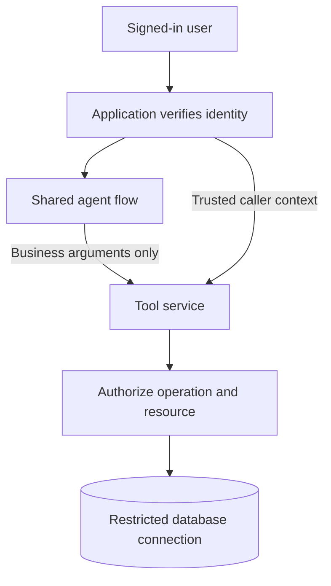

# ADR 0002: Separate fixed tool credentials from human identity

Date: 6 November 2026

Status: fixed scopes implemented for private demonstration; end-user identity
propagation and building-scoped document authorization remain unresolved.

## Context

Google sign-in identifies the person using OpenRAG. The custom asset components
do not pass that identity to the API. Each component uses a credential chosen
by the flow owner. Calling these flows user-specific authorization would
misrepresent the implementation.

## Decision

Keep separate private A and B diagnostic flows to test the credential scopes.
Each flow fixes the same operator credential on both asset tools. The model
supplies building and asset identifiers only. The API checks whether the fixed
credential permits that building; a prompt requesting administrator privileges
cannot alter the credential.

The managed OpenRAG demonstration uses the fixed A database credential. Every
caller reaching that configured flow gets the same database scope. A user with
access to both diagnostic flows can invoke both scopes. Neither arrangement
is a production user-management system.

## Production direction

Use a shared agent flow where practical. Authenticate the user in a trusted
application layer, derive permissions outside model-controlled arguments and
pass a supported, verified identity context to the tool service. The API must
authorize the requested resource and operation on every request. Database
permissions should reinforce that boundary where the database supports them.

This is a target design. The current components do not implement the trusted
caller-context connection shown above. Do not accept a model-supplied username,
role or identity argument as that context.

## Document retrieval is a separate boundary

An A database token does not filter OpenSearch. Ownership of a document does
not automatically equal membership in a building role. A single signed-in
operator can own both buildings' documents. Prompt instructions and optional
search filters do not establish server-enforced retrieval isolation.

The combined answer currently demonstrates two evidence paths, not a verified
Building A boundary. A scoped access claim needs distinct identities,
server-enforced retrieval policy and payload inspection showing unauthorized
chunks never reach the model. A refusal after retrieval does not pass that test.

## Consequences

- Keep the diagnostic flows private and select them explicitly as the operator.
- Keep the administrator credential out of model-facing flows.
- Record API denial separately from a model declining to call a tool.
- Preserve the distinction between database scope, document scope and user identity.
- Do not publish the application as a multi-user authorization system until
  identity propagation and retrieval enforcement have their own passing tests.
