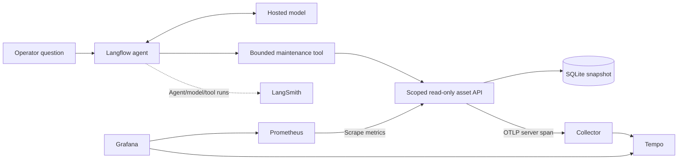
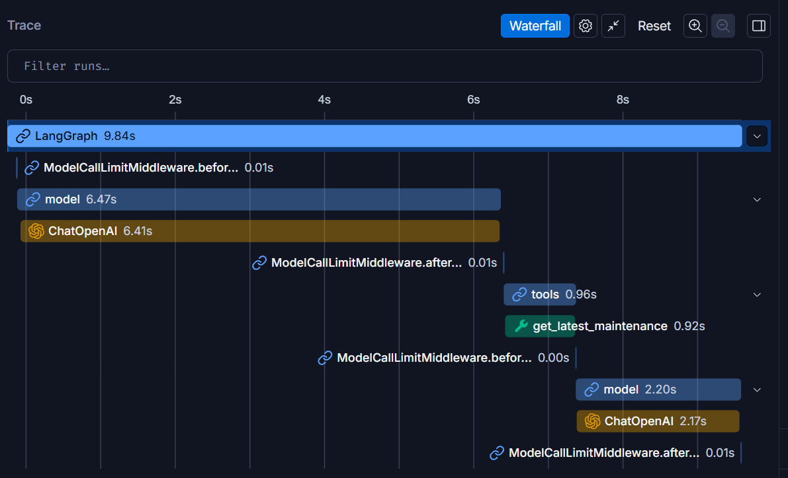
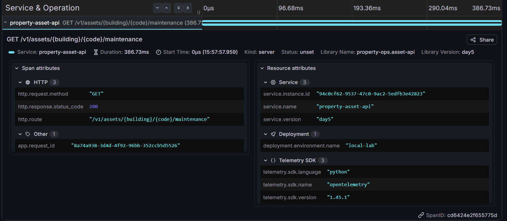

# Troubleshooting the agent and its API

An answer can be slow because the model is slow, because a tool is slow, or because
the API is slow. It can also be wrong when every HTTP request succeeds. Inspect
agent behaviour and service execution separately before choosing a fix.

## Choose the evidence for the question

| Symptom | First evidence | Follow-up |
| --- | --- | --- |
| Wrong tool or no lookup | Local Langflow run and LangSmith execution tree | Tool schema, wiring and agent instructions |
| Incorrect date or citation | Local tool payload and final answer | Verify recorded date, snapshot and returned source references |
| Slow whole answer | LangSmith model/tool waterfall | Inspect API span only if the API portion is slow |
| Tool timeout | Container health, network and API logs | A request that never reached the API has no API trace |
| Denied record | Fixed credential scope and API status | A handled 404 can be expected; never replace denial with recalled data |
| Sustained errors or latency | Prometheus counters and duration histogram | Open representative Tempo traces and inspect logs |
| Missing LangSmith runs | Runtime flags, regional endpoint, key scope and export logs | Check installed integration; avoid repeated paid prompts |
| Grafana page failure | Terminal health, service logs and resource pressure | Browser cache/extensions after server responsiveness is established |

LangSmith captures the model decision, tool execution and answer-construction
sequence. Grafana queries Prometheus for trends and Tempo for an individual API
span. API duration is neither whole-agent latency nor database-only execution time.
Nested waterfall durations overlap; do not sum parent and child durations.
With payload hiding enabled, use local Langflow details to inspect tool arguments
and returned facts. Absent usage or cost is unavailable, not zero.

## Read the two execution views

In the supplied LangSmith capture, two model calls surround the maintenance
tool. Use this view to locate model or tool time before investigating the API.
The screenshot does not expose payload privacy panels or the run identifier.

The corresponding API evidence shows a SERVER span for the templated maintenance
route with HTTP 200 and app.request_id. Use this view to inspect API execution,
not model decisions. The request ID matches the tool output and API log; the
API log and span durations differ and remain under investigation.

See the [validation record](../evidence/agent-maintenance-observability.md) for
the exact identifiers, log screenshot and remaining verification gaps.

## Correlate one execution

1. Pass the privacy canary before running property tools with tracing enabled.
2. Execute one isolated question and retain the local run identity, action and
   arguments. Record the actual LangSmith run ID and start time where available.
3. Take request_id and trace_id from that execution's tool result.
4. Retrieve the exact trace ID in Tempo. Compare app.request_id, HTTP status and
   route template with the tool result and asset_api_observed log entry.
5. Compare durations without assuming equality. Retain unexplained discrepancies.
6. Identify the corresponding LangSmith execution using available run identifiers
   and execution context. Similar timestamps alone are weak under concurrent load.

The tool, API log and Tempo share API diagnostic identifiers. LangSmith has a
separate run identity. This implementation does not propagate an OpenTelemetry
parent context from Langflow or create model/client/database child spans in Tempo.
The evidence record is a manual association, not one distributed trace.

## Protect the evidence

Keep raw exports, credentials and account configuration private. Publish reviewed
screenshots and fictional records only. A waterfall shows execution structure;
it does not prove redaction. A successful span proves service execution, not answer
correctness, document isolation or production readiness. Preserve failed or
unverified checks alongside successful observations.

See [LangSmith setup](../../integrations/langflow/langsmith.md),
[API operations](api-observability.md) and the
[agent lookup evidence](../evidence/agent-maintenance-observability.md).
