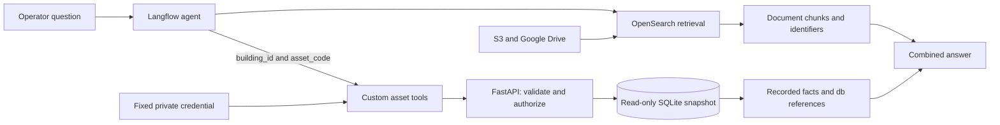
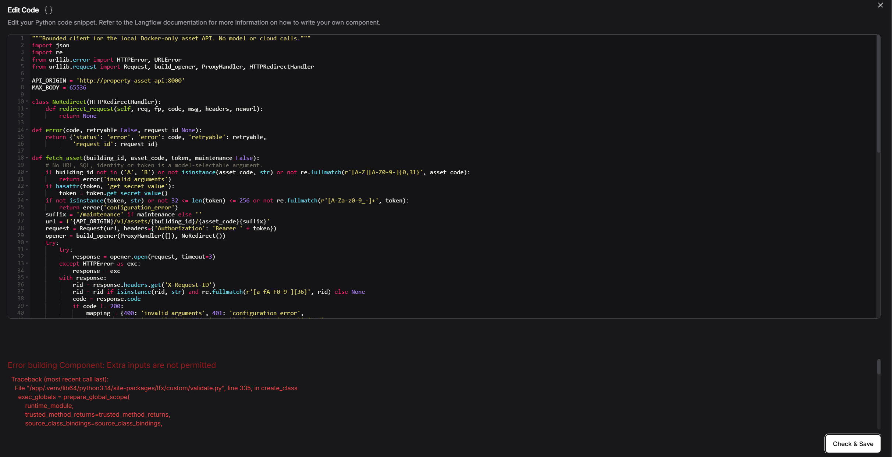
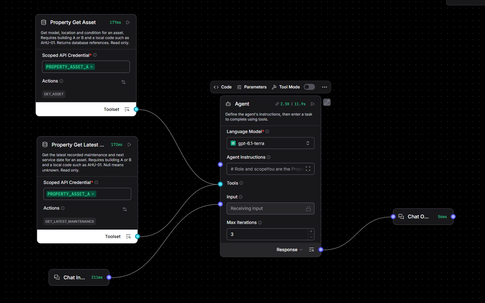
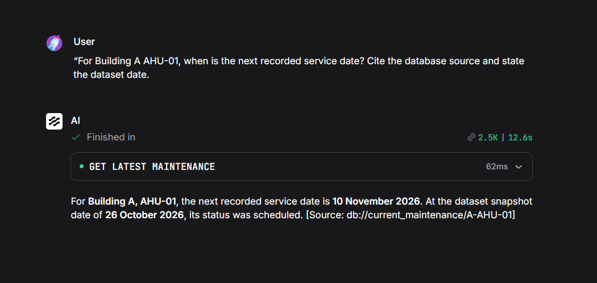
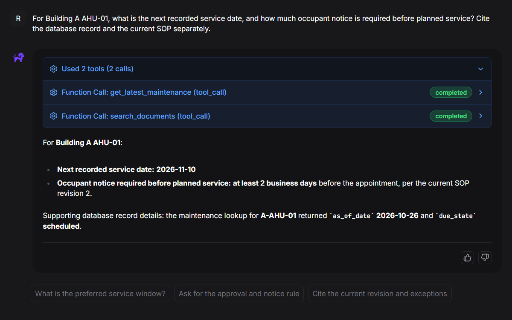

# Connecting document retrieval to recorded asset facts

The agent now has two bounded database tools alongside document retrieval.
The API supplies recorded asset and maintenance facts; indexed contracts,
manuals and procedures supply documentary requirements. The service enforces
the configured database scope before querying SQLite.

This implementation builds on the [S3 integration](s3-connector-workaround.md).
The repository adds API source, tests, container configuration, custom Langflow
components and evidence. It does not contain credentials, generated databases
or unreviewed flow exports.

## Implemented path

The source repositories feed the index through ingestion; the diagram condenses
that preparation path. The model controls business arguments, not the credential,
identity, API origin or SQL. The service runs on an internal Docker bridge with
no published host port. Langflow retains its original network for model access.

## API and client contract

The API exposes asset details and latest maintenance. It rejects query
parameters and unsupported methods, checks scope before SQL and uses
parameterised queries. Missing assets and denied scopes share an unavailable
response. SQLite connections use read-only and query-only settings.

The client fixes the destination, refuses redirects, disables proxies and
limits time and response size. It validates the returned identity, snapshot
and database references. Error responses become small structured results;
the client does not return upstream response bodies or automatically retry.

See [API reproduction](../../services/asset_api/README.md) and
[Langflow integration](../../integrations/langflow/README.md).

## Integration issues resolved

### Unsupported custom-input argument

Langflow rejected `tool_mode=False` on `SecretStrInput` with “Extra inputs are
not permitted.” Inspection of the installed input model confirmed that the
secret input does not define that field. Removing the argument allowed the
component to build. The two text inputs retain `tool_mode=True`.

The source-contract test now rejects that unsupported secret-input argument.
This is a constructor compatibility check, not proof of the generated action
schema; the flow still needs inspection after building.

### Standalone provider configuration

The diagnostic flow needed its own Langflow model-provider configuration.
OpenRAG's configured provider did not automatically populate that separate
dialog. The managed flow keeps OpenRAG's runtime model component. Credentials
remain private in both paths.

### Calling a flow instead of a database action

An intermediate managed run invoked the entire standalone flow with
`input_value` and `session_id`. The intended database actions accept
`building_id` and `asset_code`. Connecting the two custom Toolset outputs
directly to the managed Agent exposed the intended actions. A later capture
shows `get_latest_maintenance` and `search_documents` completing.

The earlier error details did not establish the nested flow's exact execution
failure. The verified correction concerns the tool interface and wiring.

## Observed behaviour

The captured standalone configuration shows fixed A credential references and
an iteration limit of three. Runtime display names may reflect earlier setup
sessions; repository paths describe components rather than an exercise schedule.

The maintenance answer reports 10 November 2026 for A/AHU-01, scheduled as of
26 October 2026, with a current-maintenance reference. A separate B-flow run
preserves B/PUMP-01's missing date and reports unavailable for A lookups.

The combined result gives the recorded date and the current SOP's two-business-
day notice. Both tool entries show completed. Exact source citations are not
visible in that final answer, so full provenance remains unverified. Retrieved
payload visibility, request-ID correlation and building-scoped document access
also need separate evidence.

The [validation record](../evidence/asset-tools-validation.md) distinguishes
automated checks, operator screenshots and pending claims.

## Decisions and production direction

- [API operations and database access controls](../decisions/0001-api-and-database-access.md)
- [Fixed tool scopes and human identity](../decisions/0002-fixed-scope-and-user-identity.md)
- [Recorded facts and source attribution](../decisions/0003-recorded-facts-and-source-attribution.md)

The next production boundary is trusted end-user identity propagation plus
server-enforced document access. The current fixed A/B flows demonstrate
credential scopes. They do not replace user management or a database's own
security controls. OTEL export and broader model evaluation remain future work.
