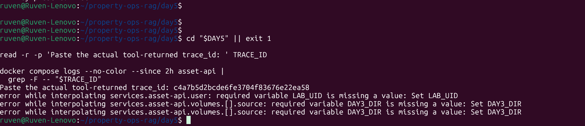
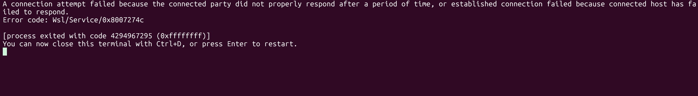

# Monitoring validation and operational limits

This record separates completed observations from checks still missing before
broader evaluation. It incorporates selected captures from 14 November 2026;
it is not a claim that every planned failure scenario was executed.

## Compose interpolation is not an API failure

A log-inspection command failed because LAB_UID and DAY3_DIR were missing in
the new shell. Compose evaluated the deployment file before reading logs. That
error does not prove the running API or its credentials failed.



For that existing deployment, re-establish the known runtime variables in WSL
before using its Compose commands:

```bash
export DAY3_DIR="$HOME/property-ops-rag/day3"
export LAB_UID="$(id -u)"
export LAB_GID="$(id -g)"
test -f "$DAY3_DIR/data/property_ops.sqlite"
```

Confirm the path matches the API's actual database mount. Do not use these example
paths for a different deployment. Avoid printing resolved Compose configuration
because it can include secrets. Narrow docker logs on a verified existing API
container can inspect evidence without Compose interpolation:

```bash
read -r -p 'Actual trace ID: ' TRACE_ID
docker logs --since 2h property-ops-day5-asset-api-1 2>&1 |
  grep -F -- "$TRACE_ID"
```

The supplied later log capture returned the same request/trace IDs already
published in the [maintenance record](../evidence/agent-maintenance-observability.md).
That is a successful log-inspection workaround, not a new API execution or a
resolution of the recorded duration discrepancy. The duplicate log and Tempo
screenshots are reused through that record rather than committed a second time.

## WSL connection timeout

Another capture shows Wsl/Service/0x8007274c and a terminal exit. This establishes
a WSL service connection failure; it does not identify an API, Collector, database
or model failure, and it does not prove memory pressure caused this particular
event. No recovery result is visible in the screenshot.



Check whether WSL is reachable and whether service processes are running before
repeating application tests. Preserve pending files and container state. A forced
WSL shutdown interrupts services and should not be an automatic first response.
Earlier measured Grafana resource pressure is documented separately in the
[API operations notes](api-observability.md).

## Current evidence matrix

| Capability or check | Published evidence |
| --- | --- |
| API instrumentation and offline telemetry checks | Committed source and earlier test record |
| Successful direct lookup and stored Tempo span | Earlier API correlation captures |
| Grounded agent maintenance answer | Recorded date, snapshot and database reference |
| API log and tool diagnostic IDs | Exact match in the maintenance evidence |
| LangSmith parent/model/tool execution structure | Separate model and maintenance waterfalls |
| Registered Local destination and APAC routing | Added routing captures; no universal export guarantee |
| Parent/model input and output panels | Empty in inspected screenshots |
| Metadata fully hidden | Not established; retained fields documented |
| Exact LangSmith-to-local run association | Still unverified without shared run evidence |
| Live denial trace plus 4xx increment | Not supplied in this batch |
| API outage and verified recovery | Not supplied in this batch |
| Collector interruption and observed delivery | Not supplied in this batch |
| Populated four-panel Grafana dashboard | Not supplied in this batch |
| Provider token/cost reconciliation | Not supplied; $0.00 in LangSmith is insufficient |
| End-to-end distributed trace | Not implemented |

The B database-flow wiring capture shows two tools referencing PROPERTY_ASSET_B,
model gpt-6.1-terra and maximum iterations 3. It establishes configuration, not
successful execution, scope-denial evidence or a frozen evaluation baseline.
No evaluation case is marked passed from that wiring alone.

## Screenshot selection

Nine new images are embedded in the routing, privacy and operations records.
Empty/setup-screen variants, generic install snippets, redundant wiring and
already-published maintenance captures are excluded. No image was altered.
The selected captures show no API-key values, bearer tokens, cookies or email
addresses. Ruven Guna appears in the overview with the owner's prior permission.
Diagnostic IDs and fictional property references are retained for evidence.

This set adds meaningful integration observations while retaining incomplete
checks. Evaluate supported branches with recorded limitations; do not convert
an unavailable prerequisite into a successful refusal or accuracy result.
