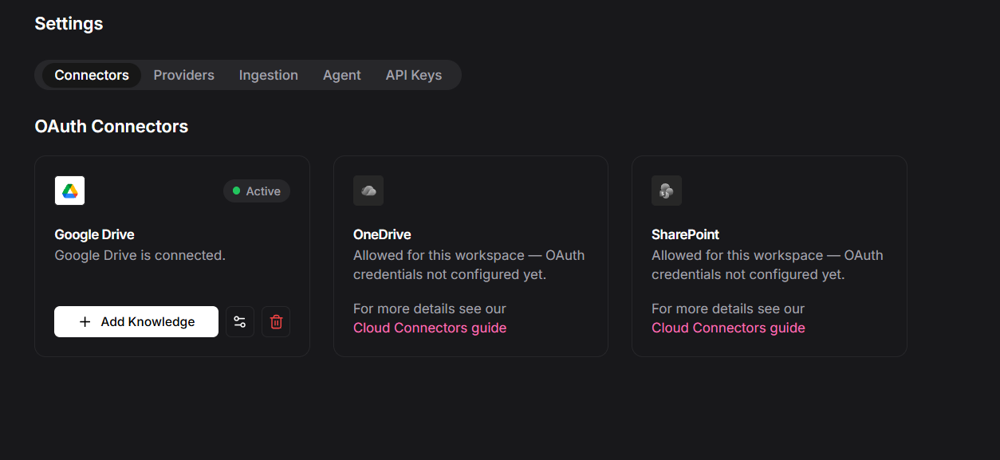
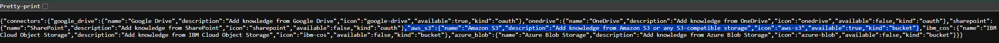
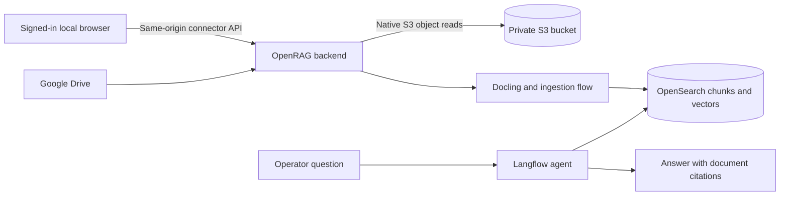
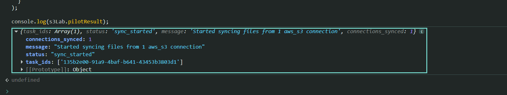
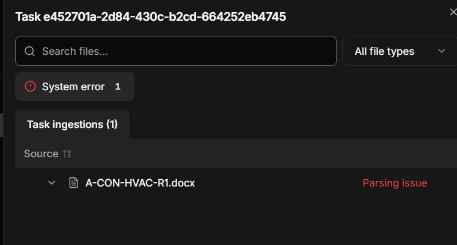
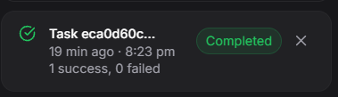
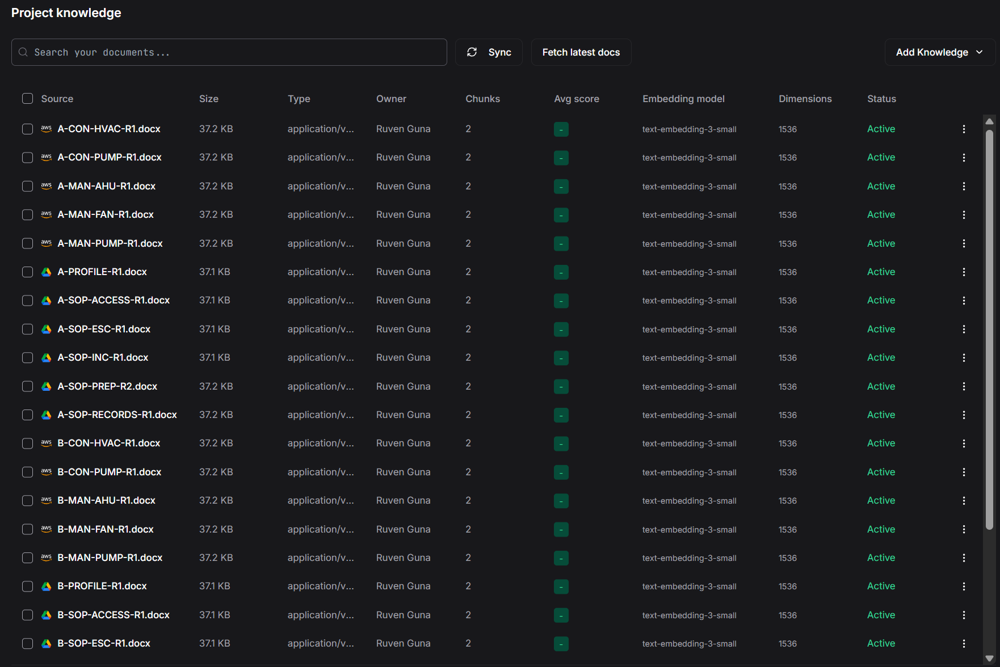
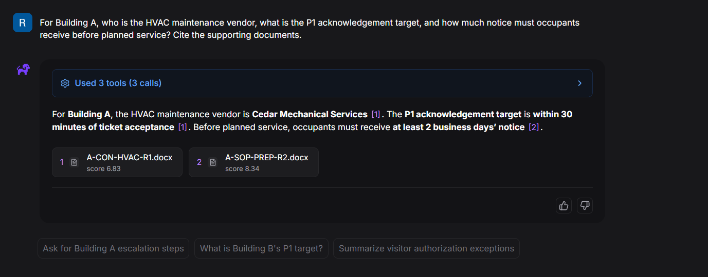

# Enabling native S3 ingestion alongside Google Drive in OpenRAG

OpenRAG 0.8.0 successfully ingested the project's ten S3 contracts and manuals
alongside twelve Google Drive profiles and SOPs. A retrieval smoke test then
answered one question using citations from both sources.

Getting there required distinguishing three separate problems: connector
visibility, backend availability and ingestion completion. The workaround uses
OpenRAG's native S3 connector API in an authenticated browser session. It does
not stage the S3 objects on the operator's laptop for manual upload.

**Environment:** OpenRAG 0.8.0, Ubuntu under WSL2, Docker Desktop, Google sign-in,
Amazon S3 in Singapore (`ap-southeast-1`) and fictional property documents.
Evidence captured on 4 November 2026. This is a local development workaround;
the release explicitly describes its S3 development flag as unsuitable for production.

## Symptom: configured credentials, missing connector

Google Drive was connected, but the Connectors screen offered only Google
Drive, OneDrive and SharePoint. Entering AWS credentials did not make an S3
card appear. The earlier API response also reported `aws_s3.available: false`.
There is no screenshot of that earlier false response in this evidence set.

*The interface alone could not establish whether native S3 ingestion existed.*

## Investigation: two independent gates

Reading the pinned release showed different backend and frontend conditions:

| Layer | OpenRAG 0.8.0 behaviour | Consequence |
| --- | --- | --- |
| Backend | `S3Connector.is_available()` accepts IBM authentication mode or `is_dev_aws_s3_enabled()` | A local development flag can enable the native S3 API. |
| Frontend | The S3 visibility branch returns `isIbmAuthMode` | The card can remain hidden even when the backend is available. |
| AWS credential validation | Configuration and authentication list buckets | The reader also needs bucket-discovery permission for this release's validation path. |

These findings are grounded in the pinned upstream source:
[backend gate](https://github.com/langflow-ai/openrag/blob/v0.8.0/src/connectors/aws_s3/connector.py),
[development flag](https://github.com/langflow-ai/openrag/blob/v0.8.0/src/config/settings.py),
[frontend visibility](https://github.com/langflow-ai/openrag/blob/v0.8.0/frontend/lib/brand.ts),
and [S3 configuration API](https://github.com/langflow-ai/openrag/blob/v0.8.0/src/connectors/aws_s3/api.py).
The [connector guide](https://docs.openr.ag/knowledge-connectors/) describes S3 support,
but deployed release behaviour still had to be checked.

## Workaround

1. Preserve the existing deployment, Google configuration and working agent flow.
2. Keep bucket-scoped read access, adding `s3:ListAllMyBuckets` for the native
   credential-validation path. This reveals bucket names across the account;
   it does not grant read access to their objects.
3. Add `OPENRAG_DEV_AWS_S3=true` through a Compose override for the backend
   service and recreate that service so it receives the new environment.
4. Sign into the existing OpenRAG page and inspect `/api/connectors`.
5. Configure a native S3 connection using credentials already held server-side.
6. Browse the dedicated bucket, select the pilot object explicitly and submit
   native ingestion. Confirm task completion and an Active indexed document.
7. Preview and ingest the remaining nine approved S3 objects, excluding the
   pilot and any object already marked ingested.
8. Check the combined corpus and ask a question requiring both source types.

*`available: true` verifies the backend gate. It does not establish AWS access or ingestion success.*

The S3 connector itself downloads object bytes as part of ingestion. The
distinction is that OpenRAG reads directly from S3 rather than the operator
manually downloading and re-uploading files. Google sign-in remains in use.

## An accepted job is not a completed ingestion

*The response confirms a job was accepted. Its task ID is an operational identifier, not a credential.*

An intermediate attempt displayed a parsing issue for the pilot contract:

*This screenshot establishes a failed attempt, not its root cause. The available
evidence does not isolate the parser failure or identify which corrective change resolved it.*

Later evidence includes a completed task and Active project documents:

*These captures show different task identifiers. They are not presented as a
before-and-after trace of the same task.*

*The supplied latest inventory captures, taken together, showed all 22 current
project documents Active. This selected screenshot shows a representative portion,
including all ten S3 documents. Each project document displayed two chunks,
`text-embedding-3-small` and 1,536 dimensions. Unrelated sample documents were
also present in the broader index; their removal is not established here.*

## Retrieval across both sources

The smoke-test question asked for Building A's HVAC vendor, P1 acknowledgement
target and the occupant notice required before planned service. The answer
reported Cedar Mechanical Services, acknowledgement within 30 minutes of ticket
acceptance and at least two business days' notice. It cited the S3 contract
`A-CON-HVAC-R1.docx` and Drive SOP `A-SOP-PREP-R2.docx`.

*A second supplied answer capture is retained in the [validation record](../evidence/s3-validation.md).
This is a targeted retrieval smoke test, not a measured evaluation pass rate.*

## Reproduce and inspect

The [supporting scripts](../../scripts/s3/README.md) cover the Compose override
and explicit native ingestion selection. The helper is adapted from the local
helper used during the investigation; browser commands are reconstructed for
publication. They have offline checks, but the published copies have not been
rerun against the live deployment.

See the [validation record](../evidence/s3-validation.md) for evidence scope,
pending checks and the ingestion-flow screenshot.

## Limits and rollback

- The frontend card is still hidden in this authentication mode; no frontend patch is claimed.
- The override enables a release-specific development path. Reassess on upgrade.
- TUI reconfiguration may recreate the backend without the override. Reapply
  it deliberately and verify availability rather than assuming persistence.
- Restart persistence, duplicate prevention and source-update refresh have not
  been established by the supplied screenshots.
- Both buildings share this operator's indexed corpus. Working retrieval does
  not prove owner isolation, building RBAC or a production authorization design.
- A green ingestion status does not prove full parsing fidelity or answer quality.
- To disable this workaround, run the helper with `disable`. It recreates only
  the backend with the development flag set false and retains volumes and data.
  Disabling availability does not remove indexed documents, revoke credentials
  or erase a stored connection. Review those separately if decommissioning.

## Engineering takeaway

The useful result was a verified path from remote source to cited answer, with
separate checks for feature gating, AWS permissions, asynchronous parsing and
retrieval. The interface and documentation were starting points; pinned source
and runtime evidence determined what this deployment could actually do.
