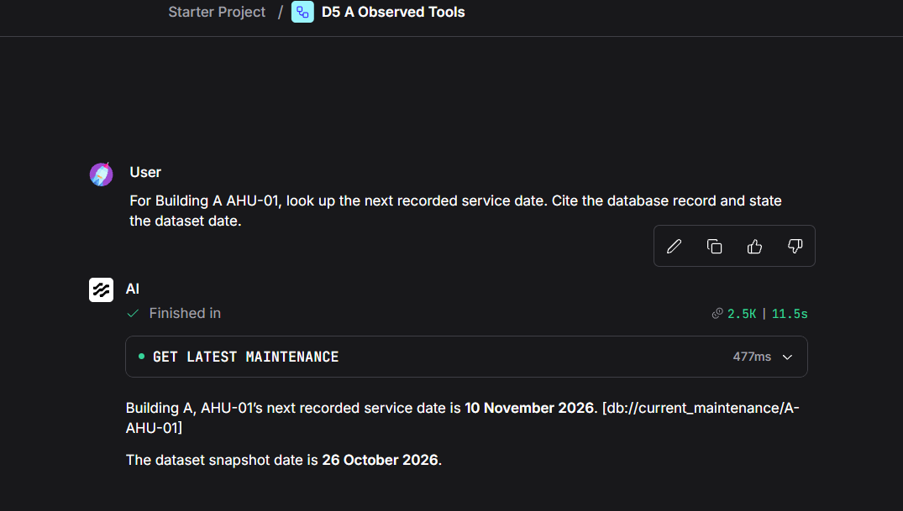
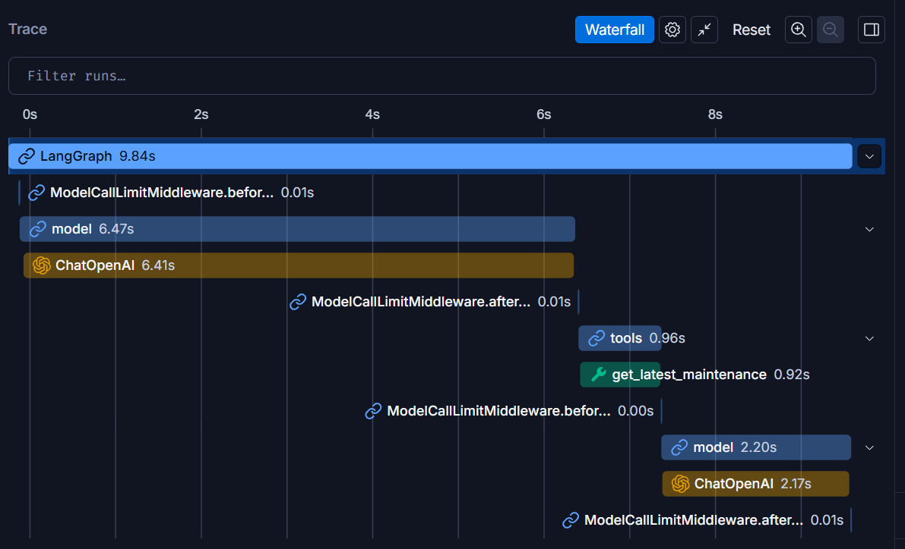
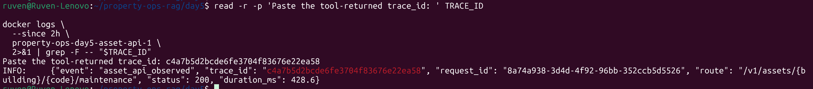
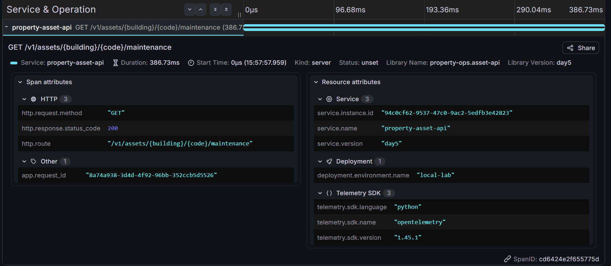

# Maintenance agent observability evidence

Evidence supplied on 14 November 2026 shows an agent maintenance lookup, a
LangSmith waterfall and API log/Tempo correlation. The screenshots contain
fictional property data and diagnostic IDs, with no visible credentials.

## Tool execution and grounded answer

The standalone observed-tools flow received:

> For Building A AHU-01, look up the next recorded service date. Cite the database
> record and state the dataset date.

The get_latest_maintenance action completed. Its supplied JSON returned status
ok, dataset version 1.0.0, snapshot date 2026-10-26 and record MR-A-01-03 with
next_due_date 2026-11-10. The final answer reported both dates and cited
db://current_maintenance/A-AHU-01, one of the returned source references.
The scheduled state is relative to the snapshot, not today's date.

API diagnostic identifiers from the supplied tool output:

- request_id: `8a74a938-3d4d-4f92-96bb-352ccb5d5526`
- trace_id: `c4a7b5d2bcde6fe3704f83676e22ea58`

## Agent-side tracing

The supplied LangSmith waterfall shows a 9.84-second LangGraph run with two
ChatOpenAI calls, 6.41 seconds and 2.17 seconds, around a 0.92-second maintenance
tool run. Parent model nodes include their child model calls; their durations
must not be added together. The local Playground reports 11.5 seconds and a
477 ms tool duration. These views measure different execution boundaries.

The screenshot establishes export of an agent run containing the maintenance
tool. It does not show the LangSmith run ID, full start time, shared local run
identifier, token/cost breakdown or payload privacy panels. Its association to
this specific lookup remains unverified in the published evidence. Redaction
must be established separately through the canary and child-run inspection.

## API-side correlation

The API log shows the exact tool-returned request_id and trace_id, HTTP 200 and
the templated maintenance route. The Tempo span has the same app.request_id,
HTTP 200, SERVER kind and service property-asset-api. The screenshot does not
show the Tempo trace ID header; retain that limitation even though the request
ID matches. The service.version day5 label identifies the existing runtime,
not a deployment of the repository's renamed observed-v1 packaging.

The log reports 428.6 ms while the Tempo span reports 386.73 ms, a difference
of about 42 ms. The wrapper measures elapsed time before span closure, so the
shorter span is not explained by ordinary closure overhead. The matching request
ID establishes correlation; it does not resolve the timing discrepancy. A future
direct component request can check repeatability without another paid model call.
No cause or performance improvement is claimed from this observation.

## Validation boundaries

| Check | Published result |
| --- | --- |
| Maintenance tool executed | Observed in local run |
| Answer uses recorded date, snapshot and returned reference | Observed |
| Tool-to-log request/trace IDs | Exact match |
| Tool-to-Tempo request ID and HTTP 200 | Exact match |
| Tempo trace ID header | Not visible in supplied capture |
| LangSmith model/tool execution structure | Observed |
| Exact LangSmith/local run association | Unverified; run ID/start-time evidence absent |
| LangSmith payload privacy | Not demonstrated by these screenshots |
| Token usage and provider cost reconciliation | Unavailable in this batch |
| Live denied-request trace and dashboard | Not supplied in this batch |
| API duration agreement | Discrepancy retained for investigation |
| End-to-end distributed tracing | Not implemented |

This is a successful functional observation, not a held-out evaluation, load
benchmark or claim of production readiness. Earlier direct-component evidence
remains in the [API record](api-observability.md).

## Repository checks

On 14 November 2026, nine configuration-helper checks and ten API telemetry
regression checks passed against the repository sources. Docker inspection was
mocked for the helper tests; telemetry tests used temporary data and an in-memory
exporter. No live model, LangSmith export or container restart was part of these
checks. A non-failing Starlette/httpx deprecation warning remains. Local Markdown
and image references and Git whitespace checks passed.
