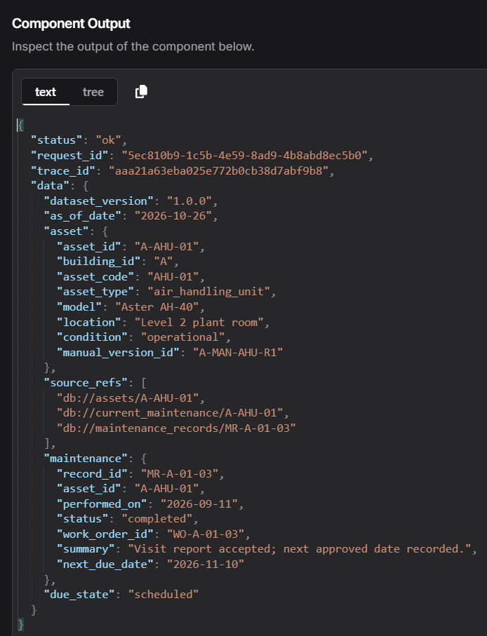
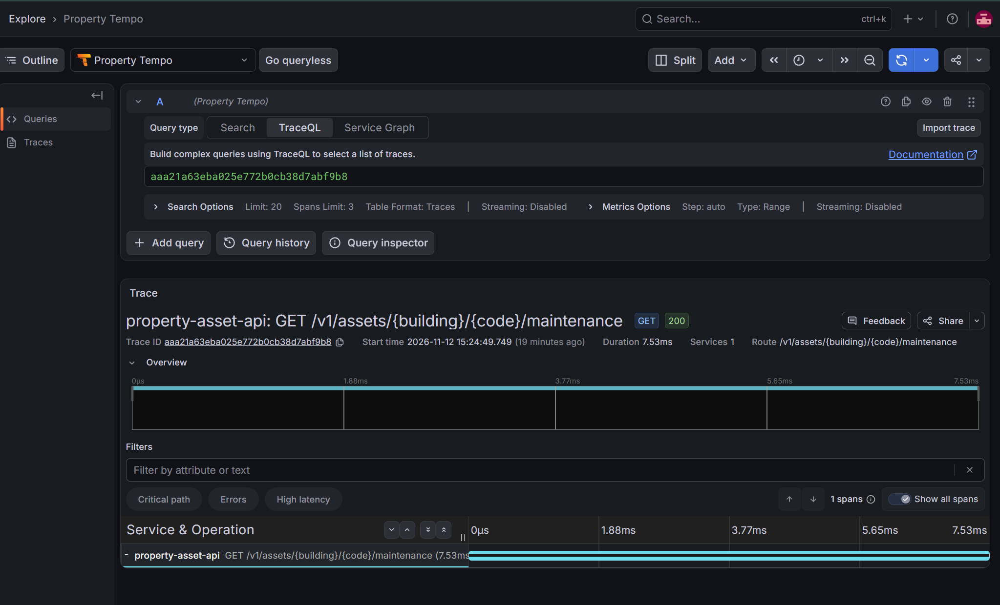
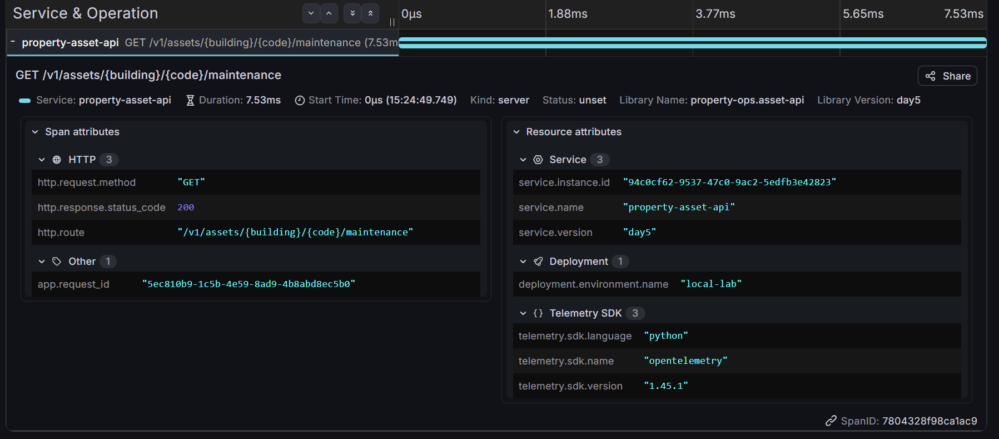

# API observability evidence

Operator captures from 12 November 2026 show a successful direct maintenance
lookup and its stored API span in Tempo, viewed through Grafana. They establish
API-level correlation. They do not establish whole-agent tracing, performance
under load, live denial behaviour or answer correctness.

## Successful request

The component returned status ok for fictional asset A-AHU-01, dataset version
1.0.0 and snapshot date 2026-10-26. Its recorded next service date was 2026-11-10.
The scheduled due_state is relative to the snapshot, not the capture date.

The result carries:

- request_id: `5ec810b9-1c5b-4e59-8ad9-4b8abd8ec5b0`
- trace_id: `aaa21a63eba025e772b0cb38d7abf9b8`

These are diagnostic identifiers, not credentials. The payload contains only
the project's fictional records and database source references.

## Stored trace

Grafana retrieved the same trace ID from Property Tempo. The view shows one
service and one span for the maintenance route, HTTP 200 and duration 7.53 ms.

Expanded attributes show the matching app.request_id, GET method, route
template, HTTP 200, SERVER kind and OpenTelemetry SDK 1.45.1. UNSET is the span's
status; it is not a failed HTTP result. This screenshot identifies the running
implementation as service.version day5. The repository uses the professional
label observed-v1 for new deployments; the screenshots document the existing
deployment, not a rerun of the renamed packaging.

The 7.53 ms value measures this API span only. It is not chat latency, model
latency, a database-only measurement or a p95 result. Matching log correlation
is supported by the source implementation but is not visible in these captures.

## Evidence status

| Check | Status in this publication |
| --- | --- |
| Successful direct component result | Observed |
| Trace retrieved from Tempo | Observed |
| Component/trace request-ID match | Observed |
| Expanded HTTP status and route template | Observed |
| Prometheus business counter | A separate capture shows a 2xx series with value 1; full query context is absent |
| Request-rate query | Capture shows 0 during an idle window; not a throughput benchmark |
| p95 query | Capture shows NaN; no useful latency percentile established |
| Populated four-panel dashboard | Not captured in this batch |
| Live denied-request trace and 4xx increment | Not captured in this batch |
| Exact log/trace comparison | Not captured in this batch |
| LangSmith export and privacy canary | Pending |

Automated telemetry tests are recorded separately from live integration
evidence. No synthetic traffic or edited graph is presented as an observed
result. The screenshots have no visible API keys or bearer credentials.

Only the three focused observability captures are published here. Website,
DNS, domain-registration, analytics-account and calendar captures are unrelated
and excluded. No email-bearing browser screenshot is included.

## Repository validation

On 13 November 2026, the portfolio source passed 10 telemetry tests, 12 bounded
client tests and 14 API regression tests in the existing Python 3.12 monitoring
environment. The telemetry suite uses an in-memory exporter; none of these
checks starts containers, sends LangSmith traces or calls a model. A non-failing
Starlette/httpx deprecation warning remains. Local Markdown/image links and
Git whitespace checks also passed.

The professional repository packaging uses a new Compose project name and
source labels. Its offline staging/configuration tests passed; this publication
did not deploy that renamed packaging or change the working monitoring stack.
