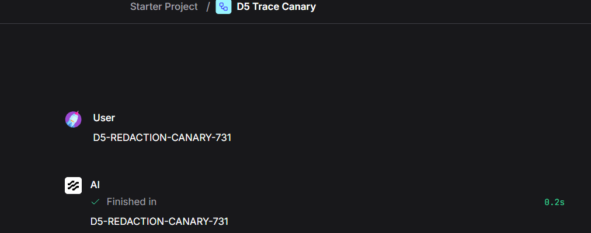
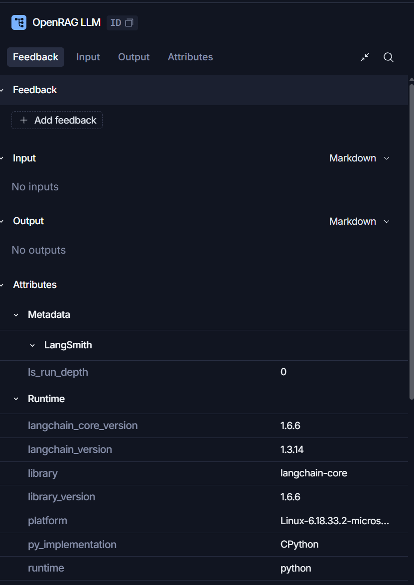
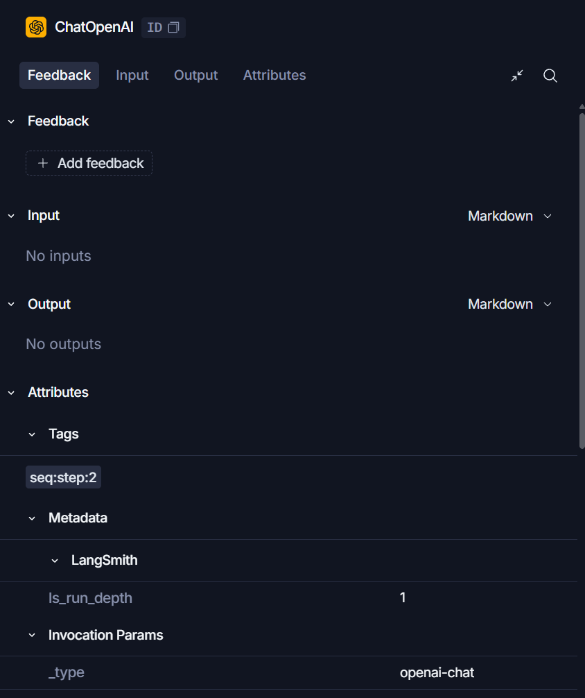

# LangSmith payload visibility review

The supplied 14 November 2026 captures support a narrower result than all
telemetry hidden: parent and model input/output panels are empty, while runtime
metadata, tags and invocation attributes remain visible. This evidence records
the privacy boundary instead of treating environment flags as a complete pass.

## Local probe

The standalone Chat Input to Chat Output flow echoed D5-REDACTION-CANARY-731
locally in about 0.2 seconds. Its supplied wiring capture contains only those
two components. It needs no model or asset credential. The local output proves
the flow ran; it does not prove that this integration exported the pass-through
graph. No shared run identifier links this screenshot to the later model run.

## Parent payload view

The exported OpenRAG LLM detail shows No inputs and No outputs. The same screen
shows ls_run_depth and runtime information, including library versions, Python
implementation and platform information. These fields remain visible; the capture
does not support a claim that all metadata was removed.

## Model-child payload view

The ChatOpenAI detail also shows No inputs and No outputs. It retains the
seq:step:2 tag, ls_run_depth=1 and invocation _type=openai-chat. Empty payload
panels are consistent with input/output hiding for these inspected runs. Without
an exact local/export run match, they do not conclusively prove that the unique
canary was stripped from this execution or that other integrations behave alike.

## Recorded environment

A separate supplied package-metadata capture reported lfx 1.12.3, langsmith
0.10.10 and langchain-core 1.6.6 inside tui-langflow. The distribution lookup for
langflow returned not installed. This is not evidence that the running editor
was absent; record the reported distributions rather than inventing a Langflow
version or upgrading the bundled environment to fix a naming difference.

## Gate status

| Check | Supported observation |
| --- | --- |
| Local pass-through canary | Executed and echoed locally |
| Parent/model tracing | Observed in the separate exported run |
| Parent input and output panels | Empty in the capture |
| Model-child input and output panels | Empty in the capture |
| All metadata removed | Not established; fields are visibly retained |
| Full metadata sensitivity review | Not established by this set of screenshots |
| Property tool/retriever payload hiding | Not shown by these two run-detail captures |
| Credentials visible in selected screenshots | None observed |

Review all available parent/child fields before accepting the remaining metadata.
If sensitive values appear, stop property-tool export and restore the original
configuration. Do not disable hide flags simply to make debugging easier. Do not
test with real credentials as a canary. The existing maintenance waterfall proves
tool execution structure, not the privacy of its child-run payloads.

See [configuration and restore workflow](../../integrations/langflow/langsmith.md)
and [routing observations](langsmith-routing-validation.md).
