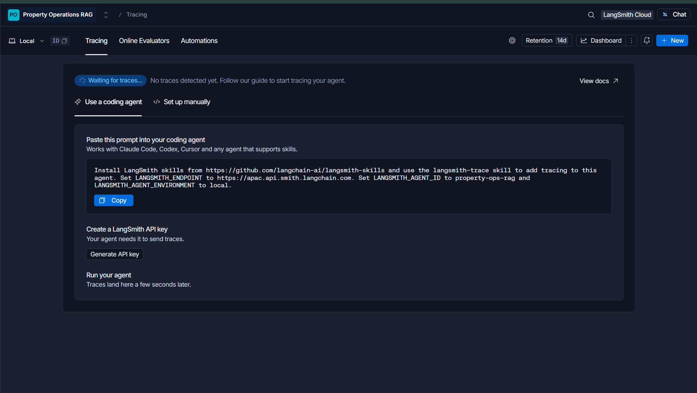
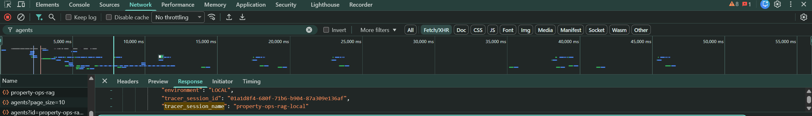
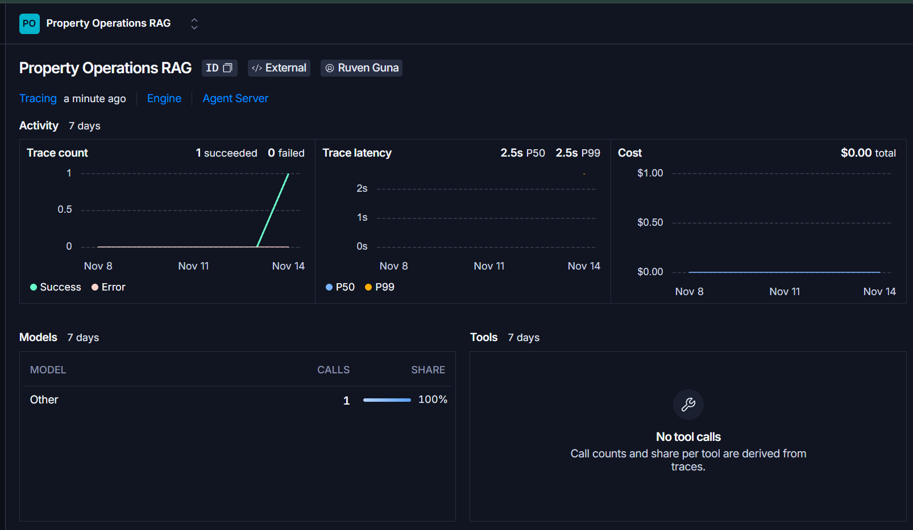
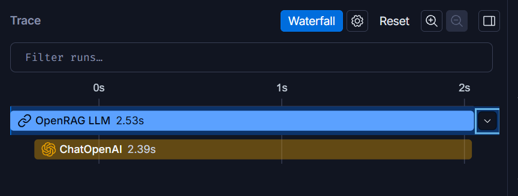

# LangSmith regional routing and export

Captures from 14 November 2026 show the investigation from an empty Local
tracing view to a successful model-call export. They extend the earlier
[maintenance lookup evidence](agent-maintenance-observability.md); they do not
turn the two runs into one correlated execution.

## Start with the destination

The registered Property Operations RAG agent initially showed Waiting for traces
in its Local environment. This is a destination/time-context observation, not
proof that the model or asset API failed. No upgrade, evaluator or hosted agent
deployment was required to diagnose it.

The browser response for the registered agent showed environment LOCAL and
tracer_session_name property-ops-rag-local. This diagnostic identified the
destination behind the Local view. The response UUID is a diagnostic identifier,
not an API key. A separate supplied request-header capture showed an HTTP 200
GET to apac.api.smith.langchain.com; that browser request alone does not prove
the Langflow exporter used that endpoint or that its key was valid.

Use the endpoint, workspace and project belonging to the actual destination.
Do not assume an older guide's example project name is the selected UI view.
The committed helper supports project-based routing and clears competing agent
and legacy aliases; the captures do not establish which particular configuration
change caused export to start. Inspect effective container settings and selected
destination before concluding that an API key is invalid.

## Export observed

The later overview shows one successful trace, zero failed traces and no tool
calls in the selected seven-day view. The cost display reads $0.00 and the model
is categorized as Other. These are UI observations, not a verified provider
charge, model identity or performance benchmark. One observation cannot establish
a useful latency distribution despite the displayed P50/P99 labels.

The expanded run is OpenRAG LLM at about 2.53 seconds with a ChatOpenAI child at
about 2.39 seconds. It establishes parent/model execution visibility. There is
no property-tool execution in this waterfall. Do not add nested durations.

The images do not expose the full run ID and start timestamp. They support this
sequence of observations, not an exact-ID association to the earlier pass-through
canary or later maintenance lookup. Review payload visibility separately in the
[privacy evidence](langsmith-privacy-validation.md).
