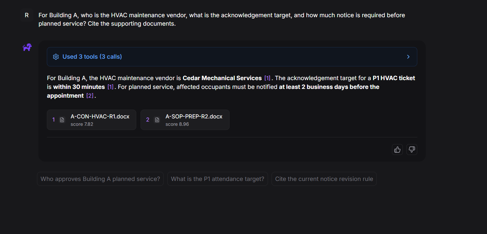
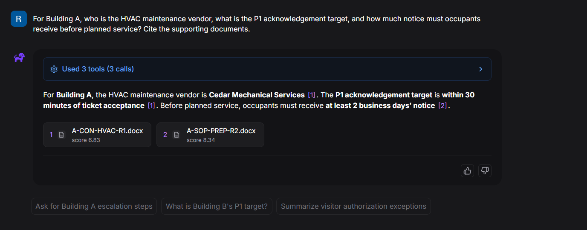
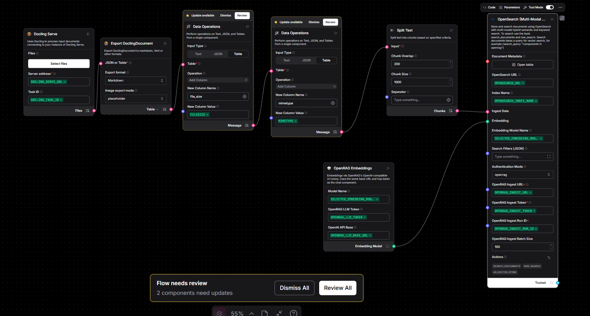

# S3 integration validation record

Recorded 4 November 2026, OpenRAG 0.8.0. Evidence consists of operator-supplied
screenshots and the investigation recorded in this project. Screenshots were
reviewed before publication: no visible credentials, tokens, cookies, account
IDs or email addresses were identified. The operator approved publication of
the displayed name, Ruven Guna. Task UUIDs are retained as non-secret operational
identifiers. Images are copied without visual edits.

## Observed results

| Check | Evidence and result | Scope |
| --- | --- | --- |
| S3 absent from settings | `01-connectors-no-s3.png` | UI symptom; does not mean the connector code is absent. |
| Backend S3 available | `02-backend-s3-available.png` shows `available: true` | Availability after workaround, not a credential test. |
| Native request accepted | `07-native-sync-accepted.png` shows `sync_started` | Job queued; completion is separate. |
| Intermediate pilot failure | `04-pilot-parsing-failure.png` shows a parsing issue | Cause not isolated by supplied evidence. |
| A subsequent task completed | `03-task-completed.png` shows one success, zero failures | Different task ID; no same-task recovery claim. |
| Corpus indexed | Latest inventory captures showed 10 S3 and 12 Drive project documents Active | Representative inventory screenshot retained; each project document showed two chunks and 1,536 dimensions. |
| Cross-source answer | `08-cross-source-answer-initial.png` and `09-cross-source-answer.png` | Two supplied captures cite the same S3 contract and Drive SOP. No statistical accuracy claim. |

The full index also contained three unrelated starter documents at the earlier
inventory checkpoint. These results do not certify their removal or a corpus
restricted to only the 22 project documents.

## Expected answer for the targeted smoke test

| Fact | Expected result | Supporting fictional document |
| --- | --- | --- |
| Building A HVAC vendor | Cedar Mechanical Services | `A-CON-HVAC-R1.docx` in S3 |
| P1 acknowledgement target | Within 30 minutes of ticket acceptance | `A-CON-HVAC-R1.docx` in S3 |
| Planned-service occupant notice | At least two business days | `A-SOP-PREP-R2.docx` in Google Drive |

The document filenames can be mapped to their repository fixtures in
`data/documents/manifest.json`. Source bucket names, source object URIs,
connection IDs, identity aliases and provider revisions stay in the private
source ledger. Screenshots establish displayed citations; they are not an
independent audit of every underlying retrieval payload.

## Ingestion-flow context

This capture shows component wiring and environment-variable references, not
credential values. The visible Split Text settings are size 1,000 and overlap
200. Two components display update warnings. Their presence is recorded without
claiming the warnings caused the parsing failure or recommending an untested
component upgrade.

## Checks still pending

- Verify the connection and indexed documents survive a controlled restart.
- Preview again after all tasks complete; confirm zero approved unindexed S3 objects.
- Verify repeated submission does not introduce duplicate indexed documents.
- Test a controlled source overwrite and deliberate refresh, separately from the corpus.
- Check parser fidelity against source document sections.
- Remove unrelated sample documents and record the final corpus inventory.
- Test unauthorized retrieval using distinct identities and inspect payloads.
- Run the evaluation suite and report measured results independently.

The publication scripts were syntax-checked and the browser selection logic
was exercised with mocked API responses. These are offline checks of the
published helpers, separate from the operator's live ingestion evidence.
