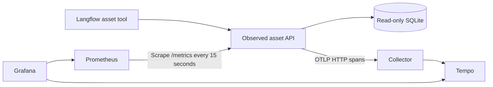

# API observability

Collect business-request metrics with Prometheus and export API server spans
through the OpenTelemetry Collector to Tempo. Grafana queries both stores.
Structured Docker logs connect a tool result to a trace through request and
trace IDs. LangSmith is a separate agent-level integration; its captured
execution tree and remaining verification gaps are documented in the
[agent evidence](../docs/evidence/agent-maintenance-observability.md).



## Coverage

- One SERVER span per business request, with method, route template, HTTP
  status and request ID. Handled 404 responses retain UNSET span status;
  responses of 500 or above mark the span as ERROR.
- A business-request counter grouped by route, method and status class, and
  a duration histogram in seconds. Health checks and metric scrapes are excluded.
- No credentials, query strings or concrete asset paths in span attributes or
  metric labels. Request and trace IDs stay out of metric labels.
- Tool clients preserve `request_id` and `trace_id` for successful and handled
  HTTP error responses. Transport failures have no invented server IDs.

There are no LLM, Langflow client or database-query child spans. The wrapper
creates an API-local trace rather than continuing incoming trace context.
This is not end-to-end distributed tracing. It also does not prove answer
correctness, source attribution or document authorization.

## Run the offline checks

From the repository root in Ubuntu WSL, use a separate Python 3.12 environment:

```bash
uv venv --python 3.12 runtime/observability-tests/.venv
uv pip install --python runtime/observability-tests/.venv/bin/python \
  -r observability/requirements.txt
runtime/observability-tests/.venv/bin/python -m unittest discover \
  -s observability -p 'test_observability.py' -v
```

The ten tests use temporary snapshots and credentials plus an in-memory span
exporter. They cover response/trace correlation, preserved access denial,
invalid credentials, server errors, low-cardinality metrics, excluded probe
traffic, payload privacy, client IDs, staging and configuration. They do not
start Docker, send external traces or call a model.

## Prepare a fresh deployment

These commands are for a new isolated deployment, not an upgrade to an existing
running project. Keep the existing working stack unchanged until you deliberately
migrate it. Never run two APIs with the `property-asset-api` network alias together.

Prepare the verified database and private credentials using the
[API instructions](../services/asset_api/README.md), then:

```bash
umask 077
export ASSET_RUNTIME="$PWD/runtime/asset-api"
export OBS_RUNTIME="$PWD/runtime/observability"
export LAB_UID="$(id -u)"
export LAB_GID="$(id -g)"
runtime/observability-tests/.venv/bin/python observability/stage_runtime.py \
  --api-source services/asset_api --runtime "$ASSET_RUNTIME" --out "$OBS_RUNTIME"
```

Staging copies source and non-secret configuration, disables the API's native
telemetry in the copied constructor to prevent duplicate instrumentation, and
generates a private Grafana password. It does not copy identities, regenerate
operator credentials, edit the original API or start containers. Existing output
is protected from overwrite. Non-secret YAML/JSON is readable by monitoring
containers; `.env` stays mode 600 and `.secrets` mode 700.

Verify or create the internal `property-ops-tools` network as described in the
API README. Stop the previous API through its own deployment configuration
before starting this one. Keep `ASSET_RUNTIME`, `LAB_UID` and `LAB_GID` exported:

```bash
cd "$OBS_RUNTIME"
docker compose config --quiet
docker compose build asset-api
docker compose pull otel-collector tempo prometheus grafana
docker compose up -d asset-api otel-collector tempo prometheus
```

Reattach the actual Langflow container to `property-ops-tools` if its launcher
recreated it. Use the updated sources in `integrations/langflow/` in a copied
diagnostic flow; retain its private credential references. Test a component
directly before invoking the agent. No model call is needed for this check.

## Networking, data and capacity

Only Prometheus (`127.0.0.1:9091`) and Grafana (`127.0.0.1:3001`) publish host
ports. Their additional normal bridge enables host access while they retain
the internal monitoring network. API, Collector and Tempo have no published
ports. Grafana uses `http://prometheus:9090` and `http://tempo:3200` internally.

Prometheus keeps up to 24 hours or approximately 256 MB of local history;
named volumes preserve monitoring state across container recreation. Do not
use `down -v` as a troubleshooting step. Tempo currently runs as root with
DAC_OVERRIDE for local volume access; this is a development compromise, not
a production hardening example.

Configured service memory ceilings total 2,560 MiB; ceilings are not reservations
or proof of fit. Grafana's 1 GiB ceiling is a trial following resource pressure
at 384 MiB. Use staged operation on the 16 GB host:

1. Stop Grafana while OpenRAG/Langflow generates direct component requests.
2. Keep Prometheus running before and after those requests; allow two scrapes.
3. Save flows and finish ingestion before stopping only the OpenRAG containers.
4. Confirm free host/WSL headroom, then start Grafana to inspect stored evidence.
5. Stop Grafana before restarting OpenRAG. Recheck network attachment if recreated.

See the [operations notes](../docs/engineering/api-observability.md) for queries
and troubleshooting, and the [evidence record](../docs/evidence/api-observability.md)
for the observed results and remaining checks.
